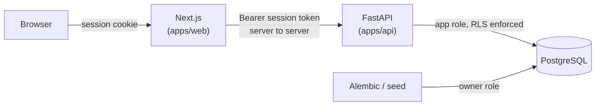
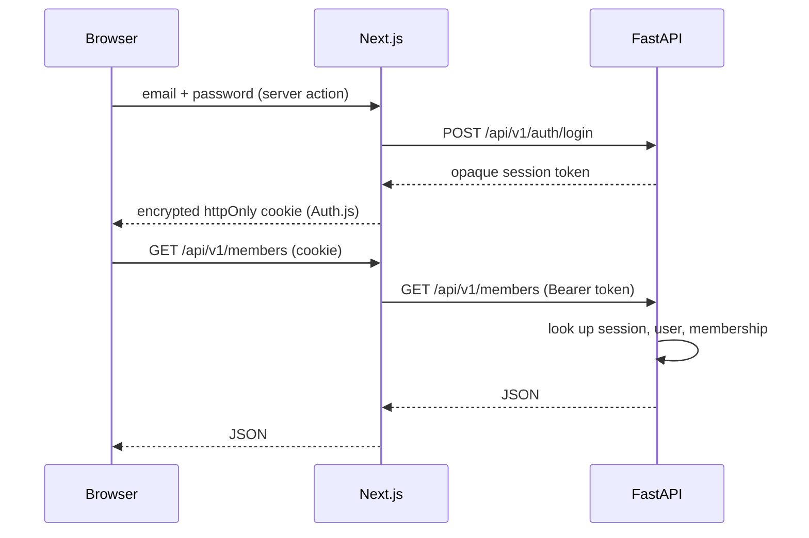

# Architecture

This document describes the system as it is built today, then the shape planned for the
modules that are not built yet. The two are kept apart on purpose.

## Overview

- **Next.js** renders the interface, runs the sign-in flow with Auth.js and proxies API
  calls from the browser. It holds no business rules.
- **FastAPI** owns business logic, authorization, validation and data access.
- **PostgreSQL** is the source of truth, and enforces tenant isolation itself.

## Tenancy

One database, one schema, an `organization_id` on every tenant-owned table. Isolation is
enforced in three independent places, so a mistake in one is caught by another.

1. **Services filter explicitly.** Every query in a service is scoped to
   `ctx.organization_id`.
2. **Row-level security.** Every table with an `organization_id` has a `tenant_isolation`
   policy comparing it to a transaction-local setting. `core/db.py` applies the settings at
   the start of every transaction (`set_config(..., true)`), so they cannot leak between
   requests through the connection pool. With no setting, a query matches no rows.
3. **Tenant-safe references.** Tenant tables expose a unique `(organization_id, id)` pair
   and reference each other through it (`tenant_fk`). A row cannot reference a row in
   another organization even if application code supplies a foreign id.

The API connects as `buildingops_app`: not a superuser, no `BYPASSRLS`, owner of nothing.
Migrations and the seed command connect as `buildingops_owner`. At startup the API checks
that its role really is subject to row-level security, and refuses to start in production
if it is not.

`tests/test_schema_invariants.py` checks the rules against the migrated database: every
table is either secured or on a short, explicit exemption list (`users`, `auth_sessions`,
`login_attempts`), every tenant table has the policy and the composite key, and the app
role has data access but no schema rights. `tests/test_rls.py` talks to PostgreSQL directly
as the app role and proves that cross-tenant reads, inserts, updates and deletes fail.

Identities are global: a `User` can belong to several organizations through `Membership`
rows, each with its own role. A platform administrator is a flag on the user, not a
membership role, and entering an organization is written to that organization's audit log.

See [decision 0001](decisions/0001-tenancy.md).

## Authentication and authorization

- The API stores only a SHA-256 hash of the session token. Sessions expire after seven days
  idle or thirty days in total, and end immediately on sign-out, password change, user
  deactivation or membership suspension, because the session is checked on every request.
- Sign-in is throttled per email and per address. Unknown emails and wrong passwords get
  the same answer and cost the same time.
- The browser never receives the token. Browser code calls `/api/v1/*` on the web origin;
  a route handler decrypts the cookie, attaches the bearer token and forwards to the API. It
  forwards an allowlist of headers (never cookies), refuses state-changing requests that do
  not come from the site itself, and will not expose the endpoints that return a token.
- Authorization is a role-to-permission matrix in `core/permissions.py`, enforced by
  `require(Permission.X)` on each endpoint. The web app receives the permission list to
  decide what to show. That is presentation; the API is the control.

See [decision 0002](decisions/0002-authentication.md).

## API conventions

- Versioned under `/api/v1`. The OpenAPI document is committed (`apps/api/openapi.json`)
  and the web app's client types are generated from it; CI fails if either is stale.
- Errors are RFC 9457 problem documents with a stable `code`, field-level `errors`, and the
  `request_id` that also appears in the logs.
- Lists take `page`, `page_size`, `sort` (`-name` for descending) and `q`, and return
  `{items, total, page, page_size}`. Sort fields are whitelisted.
- One database transaction per request. It commits before the response is sent, so a client
  never receives success for a write that then failed. Services never commit: the caller
  that created the session owns the transaction.
- Every change writes an audit entry in the same transaction, with a field-level diff. The
  audit table is append-only for every role, enforced by triggers.
- Logs are structured (JSON in production) and carry the request id, user and organization.

## Web app

- The App Router with Cache Components: each route has a prerendered static shell, and the
  part that depends on the signed-in user streams in behind a Suspense boundary after the
  session has been verified against the API.
- Data is fetched in the browser with TanStack Query through a client generated from the
  OpenAPI document, so request and response types follow the API automatically.
- List state (search, filters, sort, page) lives in the URL.
- The design system is a small set of owned components in `src/components/ui`, built on
  Radix primitives and Tailwind tokens defined in `src/app/globals.css`.

## Testing

| Level | What it covers | Where |
| --- | --- | --- |
| API | Endpoints, permissions, tenancy, sessions, audit, against real PostgreSQL as the app role | `apps/api/tests` |
| Schema invariants | Row-level security and model/migration drift; every migration runs down and up | `apps/api/tests/test_schema_invariants.py` |
| Web unit and component | Proxy route, session handling, formatting, shared components | `apps/web/src/**/*.test.ts(x)` |
| End to end | Sign-in, each role, tenant isolation, in a real browser against the real stack | `apps/web/e2e` |

## Planned (not built yet)

The following is design intent for later slices. None of it exists in the code today.

- **Background work**: Celery workers with Redis for imports, document processing and AI
  jobs. Tasks will use the same services and set the tenant context explicitly.
- **Data pipeline**: reusable extract, validate, normalize and load stages for CSV and Excel,
  processed in chunks, with entity resolution that routes uncertain matches to a person.
- **AI**: a single Claude service with structured output validated by Pydantic, retries,
  prompt versions, logged calls and source citations. Model output is treated as a proposal:
  deterministic code validates it and a person approves anything that matters.
- **Integrations**: provider adapters behind internal interfaces, with an outbox,
  idempotency keys, a change preview and reconciliation before any system-of-record write.
  Early adapters will be simulators and will say so.
- **Portals**: customer and vendor principals restricted by additional restrictive
  row-level security policies, not only by API checks.
