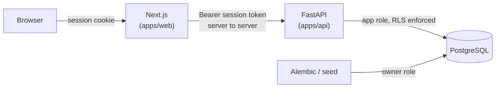
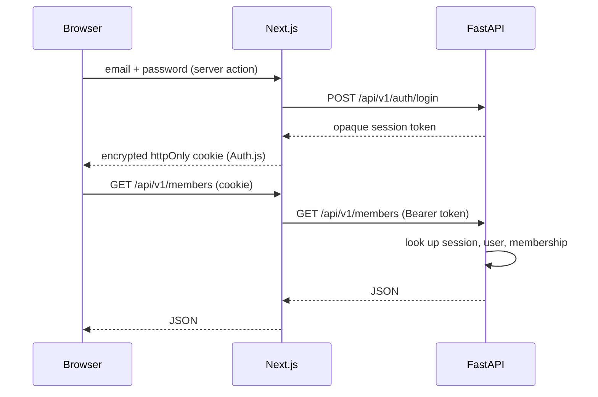

# Architecture

This document describes the system as it is built today, then the shape planned for the
modules that are not built yet. The two are kept apart on purpose.

## Overview

- **Next.js** renders the interface, runs the sign-in flow with Auth.js and proxies API
  calls from the browser. It holds no business rules.
- **FastAPI** owns business logic, authorization, validation and data access.
- **PostgreSQL** is the source of truth, and enforces tenant isolation itself.

## Tenancy

One database, one schema, an `organization_id` on every tenant-owned table. Isolation is
enforced in three independent places, so a mistake in one is caught by another.

1. **Services filter explicitly.** Every query in a service is scoped to
   `ctx.organization_id`.
2. **Row-level security.** Every table with an `organization_id` has a `tenant_isolation`
   policy comparing it to a transaction-local setting. `core/db.py` applies the settings at
   the start of every transaction (`set_config(..., true)`), so they cannot leak between
   requests through the connection pool. With no setting, a query matches no rows.
3. **Tenant-safe references.** Tenant tables expose a unique `(organization_id, id)` pair
   and reference each other through it (`tenant_fk`). A row cannot reference a row in
   another organization even if application code supplies a foreign id.

The API connects as `buildingops_app`: not a superuser, no `BYPASSRLS`, owner of nothing.
Migrations and the seed command connect as `buildingops_owner`. At startup the API checks
that its role really is subject to row-level security, and refuses to start in production
if it is not.

`tests/test_schema_invariants.py` checks the rules against the migrated database: every
table is either secured or on a short, explicit exemption list (`users`, `auth_sessions`,
`login_attempts`), every tenant table has the policy and the composite key, and the app
role has data access but no schema rights. `tests/test_rls.py` talks to PostgreSQL directly
as the app role and proves that cross-tenant reads, inserts, updates and deletes fail.

Identities are global: a `User` can belong to several organizations through `Membership`
rows, each with its own role. A platform administrator is a flag on the user, not a
membership role, and entering an organization is written to that organization's audit log.

See [decision 0001](decisions/0001-tenancy.md).

## Authentication and authorization

- The API stores only a SHA-256 hash of the session token. Sessions expire after seven days
  idle or thirty days in total, and end immediately on sign-out, password change, user
  deactivation or membership suspension, because the session is checked on every request.
- Sign-in is throttled per email and per address. Unknown emails and wrong passwords get
  the same answer and cost the same time.
- The browser never receives the token. Browser code calls `/api/v1/*` on the web origin;
  a route handler decrypts the cookie, attaches the bearer token and forwards to the API. It
  forwards an allowlist of headers (never cookies), refuses state-changing requests that do
  not come from the site itself, and will not expose the endpoints that return a token.
- Authorization is a role-to-permission matrix in `core/permissions.py`, enforced by
  `require(Permission.X)` on each endpoint. The web app receives the permission list to
  decide what to show. That is presentation; the API is the control.

See [decision 0002](decisions/0002-authentication.md).

## API conventions

- Versioned under `/api/v1`. The OpenAPI document is committed (`apps/api/openapi.json`)
  and the web app's client types are generated from it; CI fails if either is stale.
- Errors are RFC 9457 problem documents with a stable `code`, field-level `errors`, and the
  `request_id` that also appears in the logs.
- Lists take `page`, `page_size`, `sort` (`-name` for descending) and, where there is text
  to search, `q`. They return `{items, total, page, page_size}`. Sort fields are
  whitelisted. Lists of dated records take `from` and `to`, both days included. A list
  embeds the names it shows (a work order's building, a timesheet's employee), so a table
  needs one request.
- One database transaction per request. It commits before the response is sent, so a client
  never receives success for a write that then failed. Services never commit: the caller
  that created the session owns the transaction.
- Every change writes an audit entry in the same transaction, with a field-level diff. The
  audit table is append-only for every role, enforced by triggers.
- Logs are structured (JSON in production) and carry the request id, user and organization.

## Master data

Customers, buildings, vendors, job roles, employees with their building assignments, and
contracts are the shared records that later modules refer to. They follow the conventions
above and add a few of their own.

- **Codes.** Customers, buildings, vendors, employees and contracts carry a code people
  can quote (`CUS-0001`). A code can be typed in, and is then kept in upper case.
  Otherwise it is the next value of a per-organization counter (`organization_sequences`),
  taken with a single upsert inside the request's transaction: two requests never get the
  same number, and a request that fails gives its number back.
- **Archiving.** `DELETE` archives. The row gets a `deleted_at`, disappears from lists and
  lookups, and frees its code. It stays readable through the records that refer to it. An
  archive is refused with a 409 while live records depend on the row: a customer with
  buildings, a job role with employees. Contracts are never archived. They end by status.
- **Staying live.** A request that makes one record depend on another (a building on a
  customer, an employee on a supervisor) reads that row with a key-share lock, and an
  archive locks its row for update before it looks for dependants. The two conflict, so
  neither can slip past the other between a check and a commit.
- **Pay rates.** Hourly rates on employees and job roles are returned, and accepted, only
  for callers with `employees:read_compensation`. Everyone else gets `null`.
- **Shared mechanics.** `core/crud.py` holds what every one of these services does the same
  way: lookups inside the organization, code assignment, applying a PATCH, archiving, and
  the audit entry for each change. Validation and read models stay in each module.

## Operational records

Work orders, shifts, timesheets, expenses, invoices and payments are the records that the
dashboard, approvals and billing compute from. Today they exist in the API and in the demo
data. Their screens are the next piece of work, and invoices and payments can only be read:
generating invoices from costs and recording payments belong to the billing module, which
is not built.

- **Work orders** move through a fixed table of statuses (`ALLOWED_MOVES` in
  `modules/workorders/service.py`). Any other move is a 409 that names the moves that are
  allowed. Starting work records when it started, completing it records when it was
  finished, and reopening it clears that. The status is changed through its own endpoint,
  never by editing the work order.
- **History.** Every status change, every change of assignee or vendor and every comment
  adds an entry to the work order's history, with the author's name copied in. Nothing
  edits or removes an entry.
- **Shifts** of one employee cannot overlap. The service checks first, so that it can say
  which shift is in the way. An exclusion constraint on the table is the guarantee: it
  also stops two requests that pass the check at the same moment, and the loser gets a
  409. A cancelled shift stays on record and frees its time.
- **Decisions.** A timesheet or an expense is entered as pending, then approved or rejected
  with a reason, and can be reopened. It can be edited only while it is pending. The three
  moves and their audit entries are shared (`core/decisions.py`). Nobody can approve their
  own time: the API refuses when the caller's login is linked to the timesheet's employee.
  Supervisors approve time. Approving expenses and reading invoices stay with managers.
- **Money.** A timesheet copies the employee's hourly rate when it is entered, so a later
  raise does not reprice past work, and its labor cost is worked out by one function
  (`modules/timesheets/costing.py`) on every write. Neither is accepted from a client.
  Amounts are rounded half up to cents by `core/money.py` and nowhere else, and are
  strings in JSON. The rate and the cost on a timesheet are hidden like other pay rates.
- **Contracts.** A work order, timesheet or expense booked to a contract must be for a
  building that contract covers, because what a contract is billed will be worked out
  from the records booked to it.
- **History outlives master data.** A record keeps the building, person or vendor it was
  for after they are archived, and goes on showing them. A reference is checked for a
  live row only when a request makes it, not when a record that already has it is saved
  again.
- **Days and times.** A time in a request must carry its UTC offset and is stored in UTC.
  "Today", for what is overdue, and the days a list of shifts asks for are the
  organization's, in its time zone.
- **Invoices** are stored with their totals. What is still owed and whether it is overdue
  are worked out when an invoice is read.
- **Demo data.** `buildingops seed` gives each demo organization a year of this, dated
  relative to the day it runs: time for everyone assigned to a building, six weeks of
  schedule, work orders with their history, expenses, and monthly invoices with payments.
  The invoices are worked out from the seeded timesheets and expenses by a stand-in for
  the billing engine (`seed/operations/billing.py`), and the tests recompute them from
  the database to the cent.

## Web app

- The App Router with Cache Components: each route has a prerendered static shell, and the
  part that depends on the signed-in user streams in behind a Suspense boundary after the
  session has been verified against the API.
- Data is fetched in the browser with TanStack Query through a client generated from the
  OpenAPI document, so request and response types follow the API automatically.
- List state (search, filters, sort, page) lives in the URL.
- The design system is a small set of owned components in `src/components/ui`, built on
  Radix primitives and Tailwind tokens defined in `src/app/globals.css`.
- Every kind of master data has a list page and one form that both adds and edits. A form
  too long for a dialog opens in a drawer beside the list. The browser checks only what it
  can know (something was entered, a number looks like a number). Everything else is the
  API's decision, and its answer is shown on the field it concerns.
- Archiving asks first, in a dialog that says what archiving means. When the API refuses
  because other records depend on the row, its explanation is shown in that dialog.
- Amounts stay decimal strings from the API to the screen and back. They are formatted for
  display and never become floating-point numbers.
- What a role may not see is left out, not greyed out: without
  `employees:read_compensation` there is no pay column, and without a write permission
  there are no buttons that change anything. The API enforces the same rules on its own.

## Testing

| Level | What it covers | Where |
| --- | --- | --- |
| API | Endpoints, permissions, tenancy, sessions, audit, against real PostgreSQL as the app role | `apps/api/tests` |
| Schema invariants | Row-level security and model/migration drift; every migration runs down and up | `apps/api/tests/test_schema_invariants.py` |
| Database rules | CHECK and exclusion constraints, partial unique indexes and tenant-safe references, written to as the owner role | `apps/api/tests/test_master_data_constraints.py`, `test_operational_constraints.py` |
| Demo data | The seed is repeatable, can run on any day, and its invoices add up to its costs | `apps/api/tests/test_seed_and_cli.py` |
| Web unit and component | Proxy route, session handling, formatting, shared components, what each form checks and sends | `apps/web/src/**/*.test.ts(x)` |
| End to end | Sign-in, each role, tenant isolation, and keeping master data, in a real browser against the real stack | `apps/web/e2e` |

## Planned (not built yet)

The following is design intent for later slices. None of it exists in the code today.

- **Background work**: Celery workers with Redis for imports, document processing and AI
  jobs. Tasks will use the same services and set the tenant context explicitly.
- **Data pipeline**: reusable extract, validate, normalize and load stages for CSV and Excel,
  processed in chunks, with entity resolution that routes uncertain matches to a person.
- **AI**: a single Claude service with structured output validated by Pydantic, retries,
  prompt versions, logged calls and source citations. Model output is treated as a proposal:
  deterministic code validates it and a person approves anything that matters.
- **Integrations**: provider adapters behind internal interfaces, with an outbox,
  idempotency keys, a change preview and reconciliation before any system-of-record write.
  Early adapters will be simulators and will say so.
- **Portals**: customer and vendor principals restricted by additional restrictive
  row-level security policies, not only by API checks.
